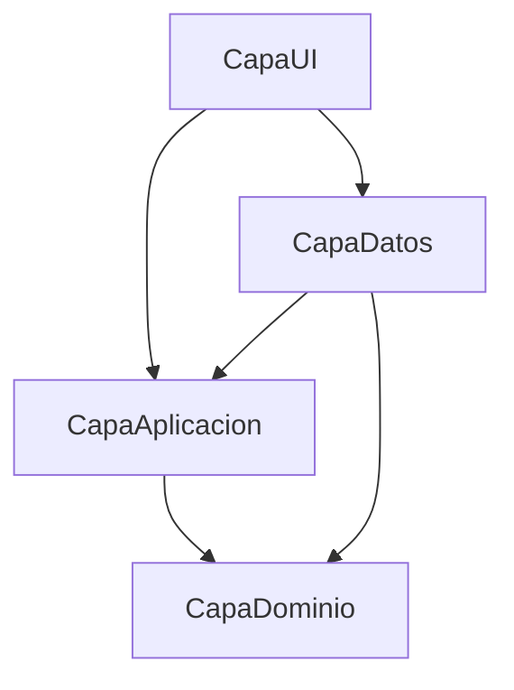

# Arquitectura Actual — Bimbo

> [!success] Actualizado 2026-11-09 — Contrato único de agentes, validador de contexto y dieta de arranque
> Implementación del estándar DevSecOps de FOE 360, CITMec y Análogos (Hito M1: R1, R2, R3). Se unificó `AGENTS.md` (<= 8 KB), se incorporaron herramientas de validación e índices generados (`INDEX.md` <= 10 KB), y se particionó la deuda técnica en `Deuda - Abierta` y `Deuda - Resuelta`. La narrativa histórica de actualizaciones previas fue trasladada a [[Historial de Arquitectura 2026]]. Ver [[2026-11-09-fernando-dieta-contexto-arranque|Sesión 2026-11-09 — Dieta del contexto de arranque]].

> [!info] Historial de Actualizaciones Previas
> La narrativa histórica detallada de callouts de sesiones (mayo a noviembre de 2026) se conserva íntegra en [[Historial de Arquitectura 2026]].

---

## Ejecutable único

**`CapaUI`** es el único ejecutable de la solución.
- Entry point: `CapaUI/App.xaml` → `App.OnStartup` (con bootstrapping de Velopack)
- Login: `LoginWindow` (WPF)
- Shell principal: `MainWindow` (WPF)

---

## Diagrama de dependencias



> [!info] Conexión a Supabase
> El singleton `ConexionSupabase` vive en `CapaDatos/Conexion.cs` (namespace `ServicioConexión.Conexion`, conservado para compatibilidad con los `using`).

> [!warning] Regla
> `CapaAplicacion` **nunca** referencia `CapaDatos`. La flecha va en sentido contrario.

---

## Proyectos en la solución

| Proyecto | Rol | TargetFramework | Ejecutable |
|---|---|---|---|
| `CapaUI` | Vistas WPF + ViewModels | `net10.0-windows` | ✅ Único ejecutable |
| `CapaAplicacion` | Interfaces, DTOs, estrategias de búsqueda | `net10.0` | No |
| `CapaDatos` | Implementaciones Supabase, repositorios | `net10.0` | No |
| `CapaDominio` | Entidades de dominio, sesión, cálculos, estado | `net10.0` | No |
| `BimboProyecto.Tests` | Pruebas unitarias de la solución | `net10.0` | No |

**Proyectos retirados históricamente:**
- ~~`ServicioConexión`~~ — proyecto huérfano retirado en septiembre 2026 (P-056).
- ~~`BimboPesaje`~~ — proyecto WinForms host retirado en mayo 2026 (C13/C14).
- ~~`CapaServicios`~~ — absorbido por `CapaDominio` en mayo 2026.

---

## Las dos rutas del módulo Productos

### Ruta A — Buscador Universal

```
UniversalSearchViewModel
    ↓ MediatR
UniversalSearchHandler
    ↓ SearchStrategyRegistry
ProductoSearchStrategy
    ↓ IRepository<Producto>
ProductoSearchRepository → Supabase
    ↓
Producto (entidad de dominio)
```

### Ruta B — Formulario de Productos

```
ProductosViewModel
    ↓ IProductoRepository
ProductoCrudRepository → Supabase
    ↓
ProductoDto (DTO de aplicación)
```

---

## Realtime — arquitectura vigente

La bandeja interna usa Supabase como única fuente de verdad. Se suscribe primero a `notificaciones_usuario` filtrando por el usuario interno y después consulta por RPC la lista activa, las cinco recientes del desplegable y el contador de no leídas. `listar_mis_notificaciones` añade a la metadata de respuesta el nombre legible de usuarios y roles relacionados, pero conserva `tabla_origen`/`id_registro_origen` como referencias canónicas y no altera el historial. Realtime solo avisa que debe refrescarse el estado; al reconectar se recrea el canal y se vuelven a consultar las RPC. Las mutaciones individuales y masivas también terminan con esa recarga autorizada, sin modificar colecciones locales de forma optimista. Sin conexión, la bandeja se declara no disponible y no simula operaciones confirmadas. Ver [[Módulo Notificaciones]] y [[ADR-025 - Notificaciones internas con Supabase como fuente de verdad]].

```
RealtimeService (Singleton en DI)
    ├─ SuscribirAsync / Desuscribir
    └─ Observar() → IDisposable token

RealtimeAwareViewModel (base class)
    └─ Observar(tabla, handler) → auto-unsubscribe en Dispose()

ProductosViewModel : RealtimeAwareViewModel
```

---

## Patrones implementados

| Patrón | Dónde | Estado |
|---|---|---|
| [[Clean Architecture]] | Todas las capas | ✅ Implementado |
| [[Repository Pattern]] | CapaDatos/Repositories | ✅ Dos variantes |
| [[Strategy Pattern]] | CapaAplicacion/Search | ✅ Implementado |
| [[CQRS + Mediator]] | Buscador universal | ✅ Con MediatR |
| [[Observer Pattern]] | ViewModels (ObservableObject) | ✅ CommunityToolkit |
| [[Result Pattern]] | Repositorios nuevos | ✅ Implementado |
| [[Base Repository con TryAsync]] | CapaDatos/Repositories | ✅ Implementado |
| [[Interceptar Cierre de Ventana]] | MainWindow (CapaUI) | ✅ Implementado |
| [[Recuperacion de Contrasenia con Supabase OTP\|Recuperación de Contraseña OTP]] | ForgotCodePanel (CapaUI) | ✅ Implementado |
| RealtimeAwareViewModel | CapaUI/Core/MVVM | ✅ Implementado |
| Lazy DI init (App.Services) | CapaUI/App.xaml.cs | ✅ C13 — 2026-05-29 |
| SuggestionSearchBox (UserControl compartido) | CapaUI/Core/Controls/ | ✅ 2026-05-29 |
| Drill-down navigation (panel toggle) | ContactosFabricantesView, ContactosProveedoresView | ✅ 2026-06-21 |
| DPI Per-Monitor V2 + escalado multi-resolución | app.manifest + rendering en todas las vistas/modales | ✅ 2026-06-21 |
| [[Detector-de-Conexion\|Detector/Monitor de Conexión]] | `IConexionMonitor`, semáforo online/degradado/offline | ✅ 2026-05-30 |
| `SpanningGridPanel` (grilla de columnas con span) | CapaUI/Core/Controls/ — usado hoy solo por Roles | ✅ 2026-08-11 |
| [[Columna de Numero de Fila en DataGrid\|Columna # (número de fila) en DataGrid]] | `NumeroFilaConverter` + `PlantillaCeldaNumeroFila` en `Styles.xaml`; primera columna en las 10 tablas de lista | ✅ 2026-09-03 |

---

## Módulos

| Módulo | Estado | Archivos clave |
|---|---|---|
| [[Módulo Productos]] | ✅ Completo | ProductosView, ProductosViewModel, ProductoCrudRepository |
| [[Módulos de Catálogos Administrativos\|Proveedores]] | ✅ Completo | ProveedoresView, ProveedoresViewModel, ProveedorCrudRepository — creación auditada por RPC |
| [[Módulos de Catálogos Administrativos\|Fabricantes]] | ✅ Completo | FabricantesView, FabricantesViewModel, FabricanteCrudRepository — creación auditada por RPC |
| [[Módulos de Catálogos Administrativos\|Categorías]] | ✅ Completo | CategoriasView, CategoriasViewModel, CategoriaCrudRepository — creación auditada por RPC |
| [[Módulos de Catálogos Administrativos\|Presentaciones]] | ✅ Completo — CRUD por RPC segura `_seguro` (2026-09-03), UI pendiente de prueba | PresentacionesView, PresentacionesViewModel, PresentacionCrudRepository — creación auditada por RPC |
| [[Módulo Contactos (Drill-down)\|Contactos Fabricantes]] | ✅ Completo | ContactosFabricantesView, ContactosFabricantesViewModel, ContactoFabricanteCrudRepository |
| [[Módulo Contactos (Drill-down)\|Contactos Proveedores]] | ✅ Completo | ContactosProveedoresView, ContactosProveedoresViewModel, ContactoProveedorCrudRepository |
| [[Buscador Universal Bimbo]] | ✅ Completo | Multi-entidad con Strategy + Mediator |
| [[Módulo Usuarios]] | ✅ Completo (RBAC auditable y detalle de roles 2026-09-02) | UsuariosView, RolesView, RolModal, UsuarioRepository, RolRepository, RolPermisoRepository, UsuarioSesionService — CRUD + auth + permisos desde BD y Administración inmutable |
| [[Módulo Notificaciones]] | 🟢 Operativo (homologación visual y nombres 2026-09-21) | Campana con cinco recientes, bandeja paginada con filtros compartidos, modal sobre overlay, severidad visual, relaciones por nombre, lectura/archivo individual y masivo atómico, emisores idempotentes, RPC/RLS/Realtime y navegación autorizada |
| [[Módulo Empleados]] | ✅ Completo (2026-07-26) | EmpleadosView, EmpleadosViewModel, EmpleadoCrudRepository — CRUD completo, crea usuario desde empleado |
| [[Módulo Bitácora]] | ✅ Completo + reportes PDF/Excel (2026-08-16) | BitacoraView, BitacoraViewModel, BitacoraCrudRepository — consulta de auditoría, selección múltiple y reporte registrado por RPC antes de entregar archivo |
| [[Módulo Reportería]] | ✅ Cuatro reportes operativos PDF/Excel (2026-08-17) | ReporteriaView, ReporteriaViewModel, ReporteConsultaRepository, cuatro RPC de consulta — vista previa paginada y exportación auditada |
| [[Módulo Pesaje]] | ✅ Flujo rediseñado; RPC auditadas parcialmente integradas y probadas (2026-08-24) | PesajeView, PesajeViewModel, PesajeRepository — `movimientos` e ingreso de pesajes usan RPC idempotentes con RBAC y bitácora; las demás escrituras siguen pendientes de migración — ⚠️ datos de tara de prueba ([[Deuda - Abierta#P-023|P-023]]) y validación visual de estados descriptivos ([[Deuda - Abierta#P-046|P-046]]) |
| [[Módulo Configuración de Empresa]] | ✅ Implementado; validación visual manual pendiente (2026-08-15) | ConfiguracionEmpresaModal, ConfiguracionEmpresaViewModel, EmpresaRepository, EmpresaThemeService, LogoEmpresaCache, IconoSidebarCache |

### Navegación entre módulos

Cada módulo sigue el patrón: **Route key → VM marker → DataTemplate**

```
Routes.Xxx (const string)
    ↓ MainViewModel._routes dict
XxxVM (clase marcador vacía : ViewModelBase)
    ↓ DataTemplate en MainWindow.xaml
XxxView (UserControl)
```

Para agregar una pantalla nueva:
1. Crear `UserControl` + `ViewModel` en `CapaUI/Formularios/Principal/Pantallas/Xxx/`
2. Agregar constante `Routes.Xxx` y entrada en `_routes` en `MainViewModel.cs`
3. Agregar `DataTemplate` en `MainWindow.xaml`
4. Registrar en DI en `App.xaml.cs`

---

## Advertencias conocidas

_Ninguna advertencia activa._ W-001 (CS0067 `SalirSolicitado`) eliminada — evento muerto removido de `ProductosView.xaml.cs`.

---

## Próximos pasos recomendados

1. **Replicar módulo Productos** para Empleados / Movimientos — usar [[Checklist - Replicar Módulo con Realtime]]
2. **Caché en memoria** para fabricantes/países (no cambian entre sesiones) — propuesta formal en [[ADR-026 - Cache en memoria con FusionCache e invalidacion por Realtime]]
3. **Result Pattern** consistente en todos los repositorios restantes
4. **Contactos Empleados** — si aplica, usar [[Módulo Contactos (Drill-down)]] como plantilla

---

## Relaciones

- [[Historial de Arquitectura 2026]] — registro histórico de actualizaciones previas
- [[Deuda - Abierta]] — deuda técnica activa pendiente de resolución
- [[Deuda - Resuelta]] — histórico de deuda técnica resuelta
- [[Plan de CI-CD y Actualizaciones Remotas]] — diseño de entrega y empaquetado Velopack
- [[ADR-029 - Recepciones de pesaje planas con reglas en trigger de tabla]] — recepción plana y reglas en trigger
- [[ADR-027 - Codigo privado y distribucion publica de actualizaciones]] — distribución pública de actualizaciones
- [[Módulo Notificaciones]] — campana, bandeja, detalle y persistencia de notificaciones
- [[ADR-026 - Cache en memoria con FusionCache e invalidacion por Realtime]] — diseño de caché L1 e invalidación
- [[ADR-015 - Cache de catalogos mostrar y revalidar]] — caché de catálogos vigente
- [[Conocimiento Principal]] — índice maestro de conocimiento
- [[Módulo Productos]] — catálogo principal
- [[Gestor Realtime - Diseño Arquitectónico]] — WebSockets y eventos reactivos
- [[AGENTS]] — contrato y reglas de oro del repositorio
- [[INDEX]] — índice condensado de arranque
